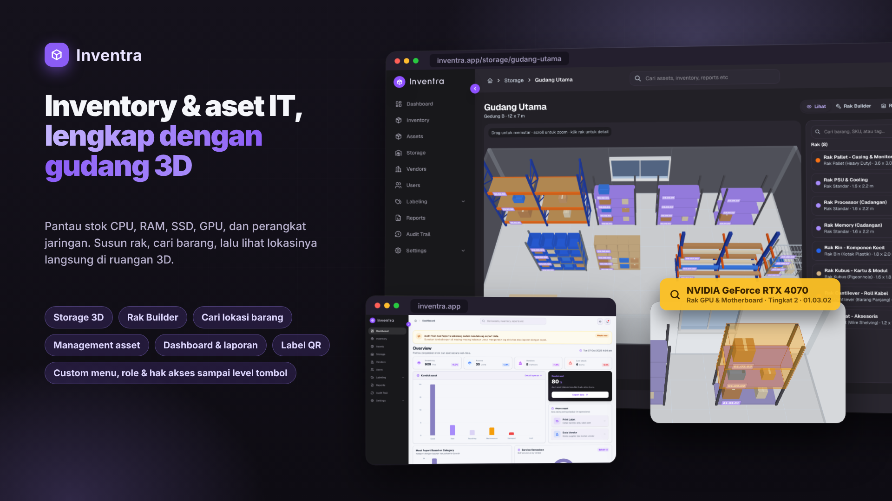

# Inventra



Sistem manajemen inventory dan aset: stok barang, aset, vendor, pengguna, laporan kerusakan, audit trail, pelabelan (QR), dan **Storage 3D** untuk menyusun ruangan, rak, pintu, dan jendela lalu menaruh barang di tiap tingkat rak.

Dibangun dengan Next.js 16 (App Router), React 19, TypeScript, Tailwind CSS 4, three.js, dan Prisma.

## Mulai

```bash
pnpm install
pnpm dev          # http://localhost:3000
```

| Perintah | Fungsi |
| --- | --- |
| `pnpm dev` | Server pengembangan |
| `pnpm build` / `pnpm start` | Build dan jalankan produksi |
| `pnpm typecheck` | Pemeriksaan tipe |
| `pnpm lint` | ESLint |
| `pnpm format` / `pnpm format:check` | Prettier |
| `pnpm db:generate` / `db:migrate` / `db:push` / `db:seed` | Prisma |

## Dokumentasi

Dokumentasi frontend ada di [`docs/frontend`](./docs/frontend/README.md):

- [Arsitektur](./docs/frontend/architecture.md): routing, struktur folder, state, tema, performa
- [Katalog komponen](./docs/frontend/components.md)
- [Konvensi](./docs/frontend/conventions.md)
- [Modul Storage 3D](./docs/frontend/storage-module.md)
- [Resep](./docs/frontend/recipes.md): menambah halaman, tabel, menu, jenis rak, menyambung API

## Status

Frontend berjalan tanpa backend: data halaman adalah data contoh, dan data yang bisa diubah (ruangan, rak, wadah, menu, role, tema) disimpan di `localStorage`. Backend (database, login, hak akses) belum tersambung.
